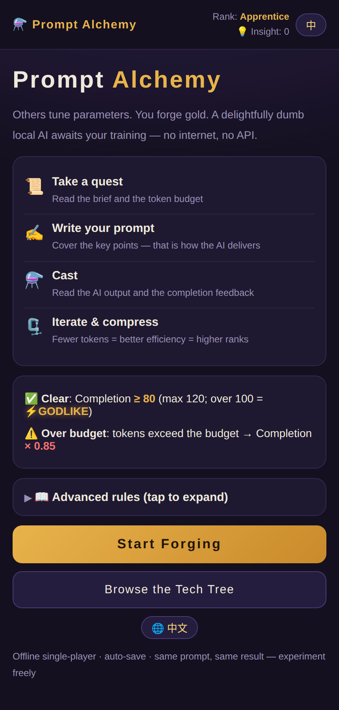
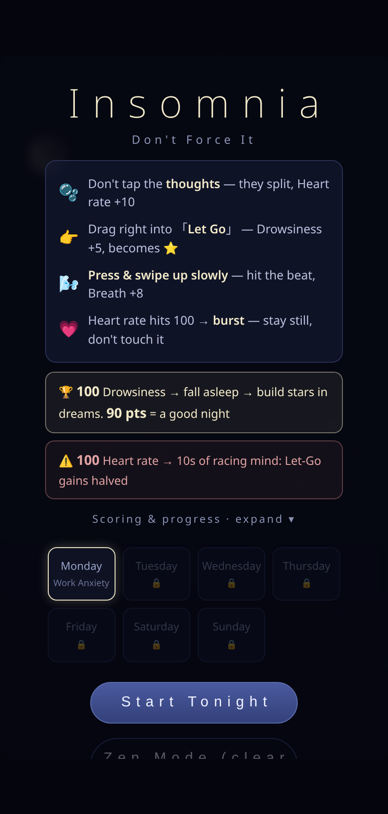
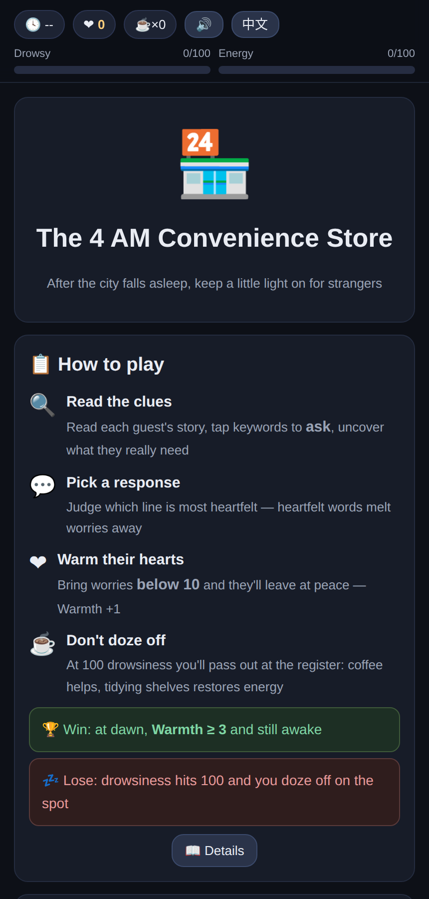
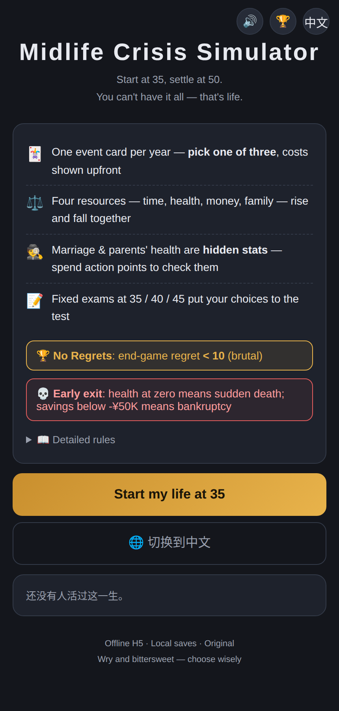
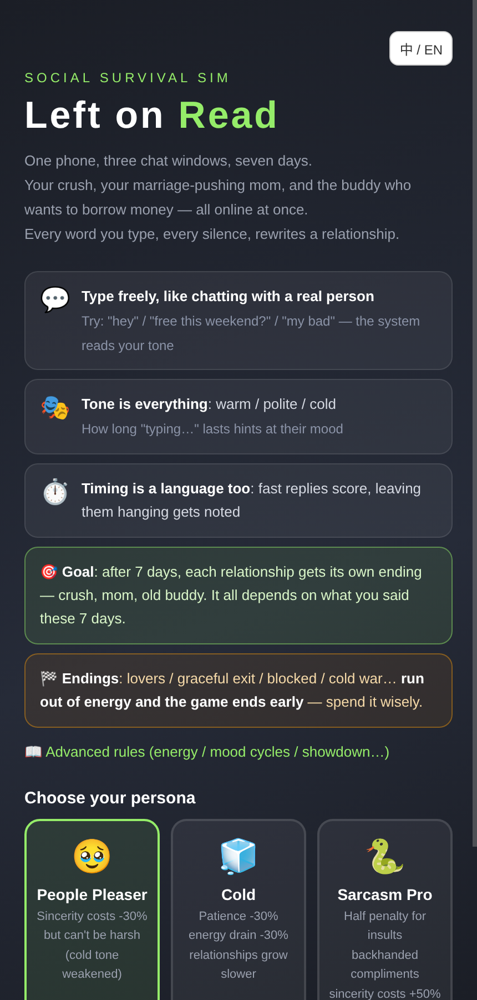
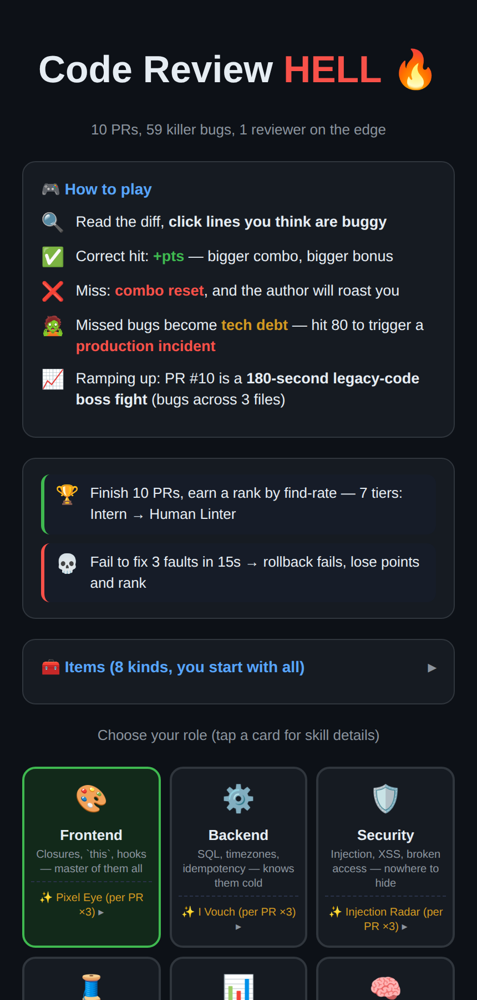
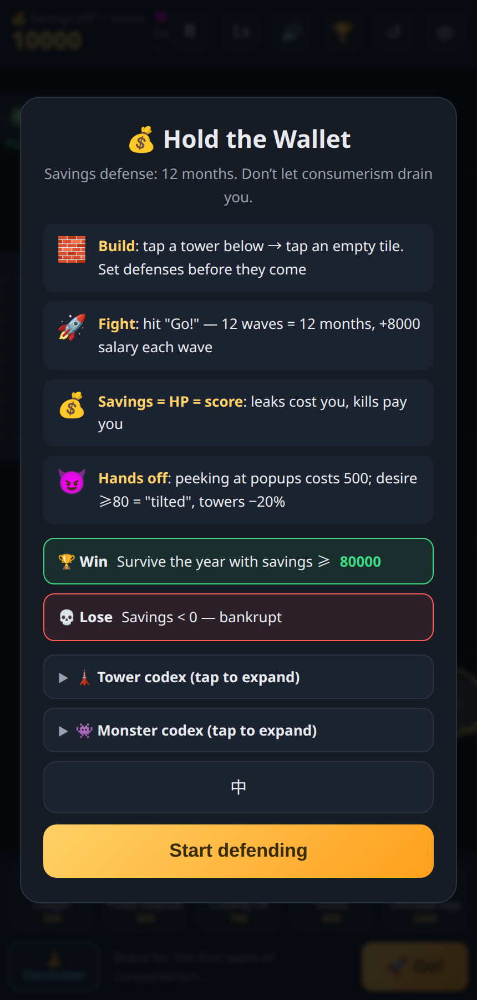
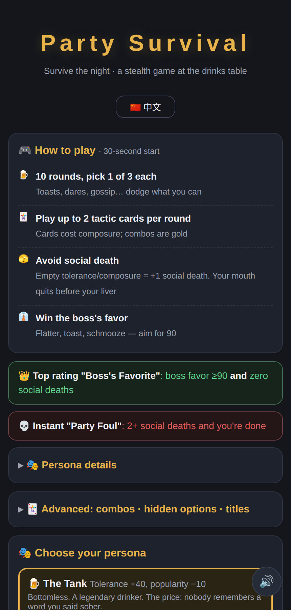
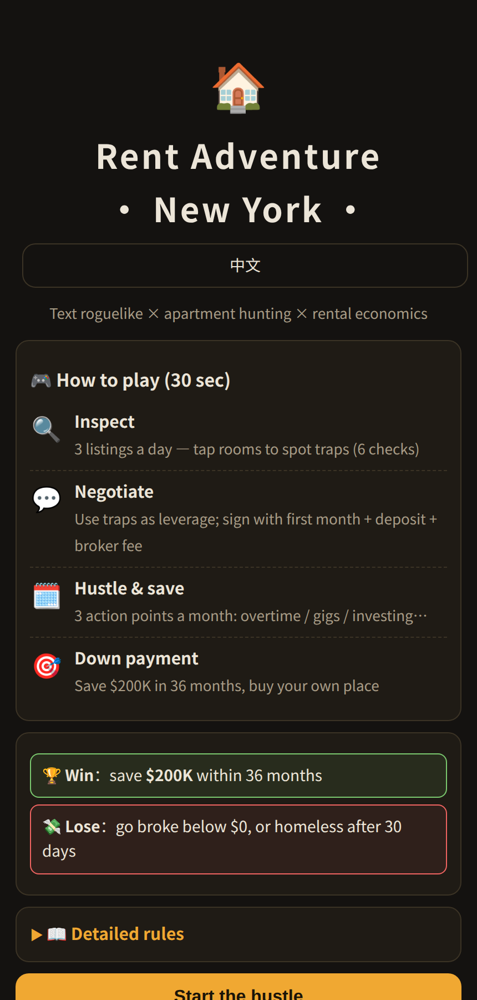
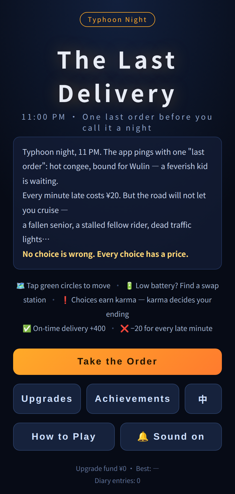

# H5 Mini Games

[](LICENSE)


Ten original single-file HTML5 mini-games. Each game is one self-contained `.html` file: zero dependencies, no build step, no network requests, no external assets. Open it in any modern browser — desktop or mobile — and play.

Every game ships with full Chinese/English bilingual support and a one-tap language toggle in the top-right corner. The default language follows the browser locale.

The collection doubles as an exercise in single-file game design — all art (CSS/emoji), audio (WebAudio), and save logic packed into one HTML file per game, playable fully offline.

## Games

### 1. Prompt Alchemy

*Strategy puzzle · Single-player*

You are a prompt engineer; the model is a delightfully dumb local AI. Each task gives you a brief and a token budget: cover every requirement in as few tokens as possible, then cast and watch the completion score. Score 80+ to clear (120 max; break 100 for the GODLIKE rank) — but blow the token budget and your score is multiplied by 0.85. Cleared tasks earn Insight points for a 12-technique skill tree. Stack techniques into combos and climb from Apprentice to Legend.



### 2. Insomnia

*Relaxation · Single-player*

Seven nights, one goal: fall asleep. Intrusive thoughts surface one by one — engage none of them; let each go cleanly to build Drowsiness. Manage heart rate and breathing rhythm across 60 thoughts, 7 nights, and 3 achievements. A game about doing nothing, deliberately.



### 3. The 4 AM Convenience Store

*Narrative · Single-player*

You're the night-shift clerk at a 24-hour convenience store. Twelve customers walk in between midnight and dawn, each carrying something unsaid. Observe the clues, ask the right follow-up, choose your response — bring their worries to 10 or below and they leave at peace. A $1,500 equipment budget, your own stamina and drowsiness to manage, and 24 fully written customer stories.



### 4. Midlife Crisis Simulator

*Life sim · Single-player*

Live from age 35 to 50. Every year deals events across career, family, health, and savings — and every choice has a price. Regret accumulates silently; spend it down or watch it rewrite your ending. 54 events, 6 epitaphs, 4 achievements. Your tombstone is the final scoreboard.



### 5. Left on Read

*Chat sim · Single-player*

Three contacts. No multiple choice — you type whatever you want, and the game reads your tone. 41 story beats across 7 days adapt to every message: relationships rise and fall, people double-text, go cold, or call you out. Leave someone on read too long and they'll start spiraling. Seven endings, from Graceful Exit to Cold War.



### 6. Code Review Hell

*Puzzle · Single-player*

59 hand-written buggy pull requests. Find the faulty line before the timer runs out — renamed variables, mutated numbers, and shuffled lines keep you honest. Skills are limited, the legacy codebase is endless, and production incidents don't wait. Climb 7 ranks, from Intern to Human Linter.



### 7. Hold the Wallet

*Tower defense · Single-player*

Your savings versus the shopping calendar: 618, Double 11, Black Friday. Place Ledger, Fixed Deposit, and Cooling-off Period towers to stop waves of Live Shopping streams and Credit Card Bills. Hold the ¥80,000 line across 12 waves — clear the first five without a single leak for a blitz bonus.



### 8. Holiday Party Survival

*Social survival · Single-player*

Ten rounds at the office holiday party. Juggle alcohol tolerance, composure, boss favor, and popularity through 24 events — toasts, small talk, karaoke ambushes. Dialogue cards in hand unlock hidden high-payoff plays at key moments. Objective: leave with dignity, bonus intact.



### 9. Rent Adventure: New York

*Life sim · Single-player*

Thirty-six months, six boroughs, one down payment. Inspect listings for traps, negotiate with landlords, survive roommates, moonlight on side gigs, and save $200K before month 36. Real NYC rent gradients, broker fees included. 50 apartment traps, 21 events, roommate storylines — and existing saves are never touched by balance patches.



### 10. The Last Delivery

*Strategy · Single-player*

A typhoon night, one scooter, a dying battery. Plan routes across 19 stops, beat shifting deadlines, and decide when a detour is worth it — like delivering medicine for Granny Chen. Battery, time limits, and karma pull in different directions. Five endings.



## Getting started

```sh
git clone https://github.com/HaYeonger/h5-mini-games.git
```

Open any file under `games/` in a modern browser (Chrome, Safari, Edge, Firefox). No server or build tooling required — opening via `file://` works. Detailed rules for each game are in [docs/games.md](docs/games.md).

## Project structure

```
h5-mini-games/
├── games/        # the ten games, one self-contained HTML file each
├── screenshots/  # preview images used in this README
├── docs/         # gameplay reference
├── README.md
└── LICENSE
```

## Notes

- All content is original.
- Progress is saved to the browser's `localStorage`; clearing site data resets it.
- Save compatibility is preserved across updates (see Rent Adventure: New York).

## License

MIT — see [LICENSE](LICENSE).
